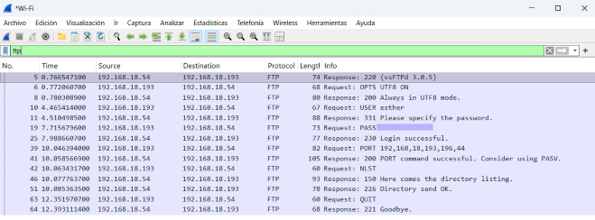
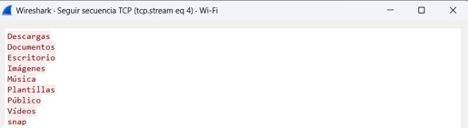
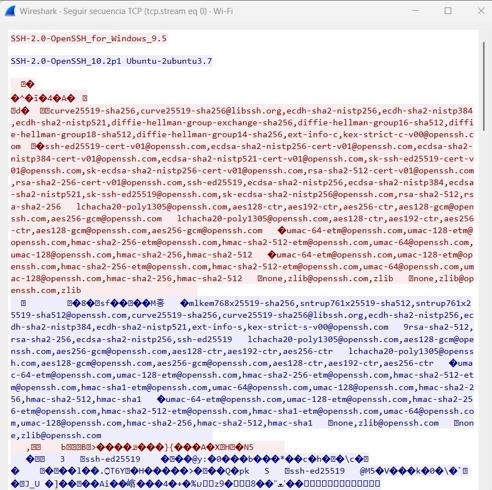
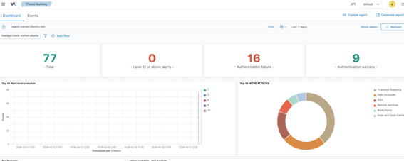
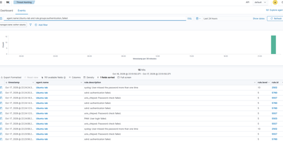
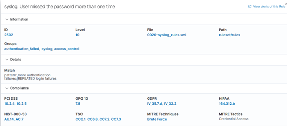

[🇬🇧 English](README.md)

# FTP vs SFTP: Análisis de tráfico con Wireshark y detección con Wazuh

Práctica de laboratorio en la que se demuestra por qué FTP es un protocolo inseguro, cómo SFTP resuelve el problema y cómo un SIEM detecta intentos de acceso por fuerza bruta.

---

## Mapeo MITRE ATT&CK

- **Tácticas:** Credential Access, Discovery.
- **Técnicas:**
  - [T1040] Network Sniffing (captura de credenciales en texto plano)
  - [T1110.001] Brute Force: Password Guessing
  - [T1078] Valid Accounts (uso de credenciales del sistema en servicios expuestos)

---

## 1. Entorno y Preparación 

El laboratorio está formado por tres equipos en la misma red local:

| Equipo | Función | IP |
|---|---|---|
| PC Windows 11 | Cliente FTP/SFTP y captura con Wireshark | `192.168.18.193` |
| Ubuntu (VirtualBox, adaptador puente) | Servidor FTP (`vsftpd`) y SSH/SFTP, con agente de Wazuh | `192.168.18.54` |
| Ubuntu Server | SIEM Wazuh 4.14.7 (manager, indexer y dashboard) | `192.168.18.113` |

El ejercicio comienza instalando el servidor FTP en la máquina virtual y comprobando que escucha en el puerto 21:

```bash
sudo apt install vsftpd
sudo ss -tlnp | grep :21
```

Desde el PC con Windows se inicia la captura en Wireshark y se accede al servidor con el cliente FTP de línea de comandos, ya que los navegadores actuales no soportan `ftp://`:

```
ftp 192.168.18.54
ls
bye
```

---

## 2. Captura de credenciales en texto plano 

Aplicando el filtro `ftp`, Wireshark muestra la sesión completa entre el cliente y el servidor, desde el saludo inicial hasta el cierre.



Del análisis de la conexión de control (puerto 21) se extrae:

- **Banner del servidor:** `220 (vsFTPd 3.0.5)` revela el software y su versión, información útil para buscar vulnerabilidades conocidas.
- **Credenciales en claro:** los comandos `USER` y `PASS` muestran el usuario y la contraseña sin ningún tipo de cifrado (la contraseña está oculta en la imagen).
- **Confirmación de acceso:** la respuesta `230 Login successful.` confirma que las credenciales capturadas son válidas.
- **Exposición del cliente:** en modo activo, el comando `PORT 192,168,18,193,196,44` revela la IP del cliente y el puerto en el que espera los datos (196 × 256 + 44 = `50220`).

---

## 3. Análisis de la conexión de datos 

En modo activo, es el servidor quien abre la conexión de datos hacia el cliente desde su puerto 20. Siguiendo el flujo TCP del paquete `FTP-DATA`, el listado de archivos del directorio del usuario aparece completamente legible.




---

## 4. Mitigación con SFTP 

Para comprobar la alternativa segura, se repite la prueba con SFTP, que funciona sobre SSH en el puerto 22 y no requiere software adicional: viene incluido en `openssh-server` y en el cliente OpenSSH de Windows.

```
sftp esther@192.168.18.54
```

Aplicando el filtro `ssh` y siguiendo el flujo TCP, solo resulta legible la fase inicial de la conexión:



- **Banners de versión** de ambos extremos (`OpenSSH_for_Windows_9.5` y `OpenSSH_10.2p1 Ubuntu`).
- **Negociación de algoritmos:** intercambio de claves (incluido el híbrido post-cuántico `mlkem768x25519-sha256`), clave del servidor (`ssh-ed25519`) y cifrado (`chacha20-poly1305`, `aes256-gcm`).

A partir del intercambio de claves, todo el tráfico está cifrado: ni el usuario, ni la contraseña, ni los comandos, ni los archivos son legibles.

| | FTP | SFTP |
|---|---|---|
| Credenciales | Visibles | Cifradas |
| Comandos y archivos | Visibles | Cifrados |
| Información en claro | Toda la sesión | Banner y algoritmos negociados |
| Puertos | 21 y 20 | 22 |

---

## 5. Detección con Wazuh 

Para la fase de detección se instala el agente de Wazuh en la máquina virtual, apuntando al servidor SIEM:

```bash
sudo WAZUH_MANAGER='192.168.18.113' WAZUH_AGENT_NAME='Ubuntu-lab' dpkg -i ./wazuh-agent_4.14.7-1_amd64.deb
sudo systemctl enable --now wazuh-agent
```


A continuación, desde el PC con Windows se realizan varios intentos de conexión SFTP con contraseñas incorrectas en menos de un minuto.

### 5.1 Visión general

Filtrando por `agent.name:Ubuntu-lab`, el dashboard de Threat Hunting refleja 16 fallos de autenticación y los asocia a las técnicas de MITRE ATT&CK *Password Guessing*, *Brute Force* y *Valid Accounts*.



### 5.2 Análisis de los eventos

Con la consulta `agent.name:Ubuntu-lab and rule.groups:authentication_failed` se obtiene el detalle de cada alerta. El campo `data.srcip` identifica el origen de todos los intentos: `192.168.18.193`.



Cada intento queda registrado por varios componentes del sistema, lo que genera varias alertas por intento:

| Regla | Nivel | Descripción | Origen del registro |
|---|---|---|---|
| 5760 | 5 | `sshd: authentication failed` | Servicio SSH |
| 5557 | 5 | `unix_chkpwd: Password check failed` | Comprobación local de contraseñas (sin IP de origen) |
| 5503 | 5 | `PAM: User login failed` | Sistema de autenticación PAM |
| **2502** | **10** | `User missed the password more than one time` | **Correlación de fallos repetidos** |

### 5.3 Correlación: regla 2502

Wazuh no se limita a registrar fallos aislados: al detectar fallos repetidos, los correlaciona en una alerta de mayor gravedad (de nivel 5 a nivel 10), asociada a la técnica *Brute Force* y a la táctica *Credential Access*, y relevante para el cumplimiento de PCI DSS, GDPR, HIPAA y NIST 800-53.



---

## 6. Remediación 

- Desinstalación del servidor FTP, que no era necesario: `sudo apt purge vsftpd`.
- Cambio de la contraseña expuesta durante las pruebas.
- Eliminación de los archivos sensibles del directorio personal.

Si fuera necesario mantener un servicio de transferencia de archivos, las recomendaciones serían:

- Usar **SFTP** o **FTPS** en lugar de FTP.
- Crear un usuario dedicado sin acceso a terminal, sin reutilizar credenciales del sistema.
- Limitar cada usuario a su carpeta (`chroot_local_user=YES`) y desactivar el acceso anónimo.
- Ocultar el banner de versión y restringir el acceso por IP con `ufw`.
- Monitorizar los accesos con un SIEM.

**Próximo paso:** configurar la respuesta activa de Wazuh para bloquear automáticamente la IP de origen ante un ataque de fuerza bruta.

---

## 7. Conclusiones 

- Analizar una sesión TCP paquete a paquete (conexión de control y de datos, modo activo de FTP) convierte la teoría sobre protocolos inseguros en algo tangible.
- El cifrado de SFTP protege credenciales, comandos y datos, aunque la versión del software y los algoritmos negociados siguen siendo visibles.
- Un SIEM aporta valor al correlacionar eventos de bajo nivel, identificar el origen de un ataque y contextualizarlo con MITRE ATT&CK.
